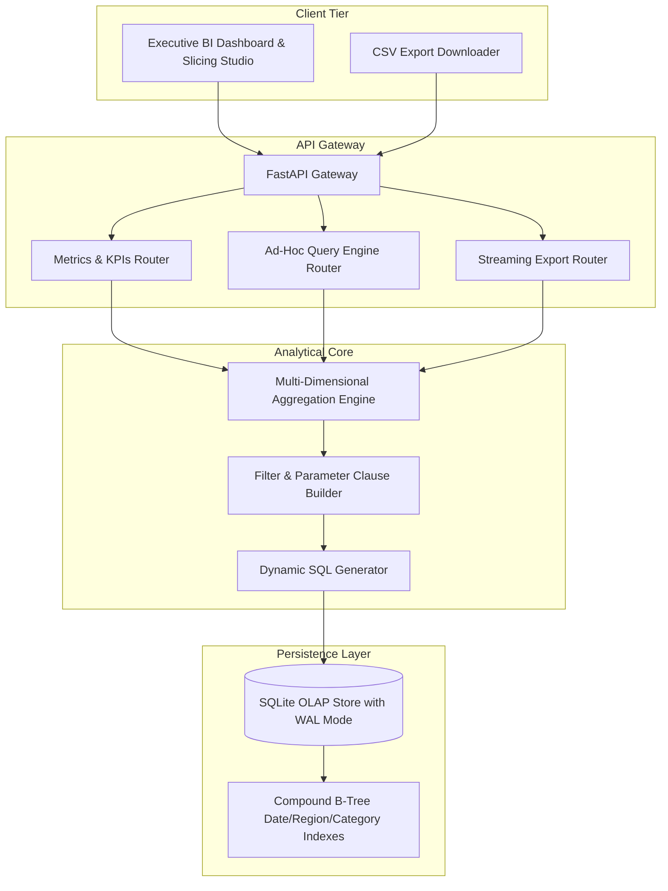

# InsightBI — Executive Business Intelligence & Multi-Dimensional Analytics Platform

[](https://github.com/Soulofghost/insightbi/actions)
[](LICENSE)
[](https://www.python.org/)
[](https://fastapi.tiangolo.com/)

InsightBI is a high-performance, production-oriented Business Intelligence (BI) and multi-dimensional analytics engine designed for executive revenue reconciliation, financial margin analysis, and ad-hoc pivot slicing across enterprise sales channels.

---

## 1. Project Introduction

InsightBI delivers real-time analytical slicing and executive KPI visualization without the heavyweight footprint of legacy BI platforms. Built on Python, FastAPI, and an optimized SQLite Write-Ahead Logging (WAL) OLAP engine, it allows corporate finance leads, revenue operations analysts, and department heads to slice high-volume transactional datasets across regions, product categories, and distribution channels.

---

## 2. Problem Statement

Modern enterprise finance and commercial operations teams face recurring analytical roadblocks:
- **Rigid Dashboards:** Off-the-shelf SaaS analytics lock users into predetermined charts, preventing customized multi-dimensional ad-hoc slicing.
- **Heavy Infrastructure Overhead:** Conventional data warehouses (Snowflake, BigQuery) introduce significant cloud query egress fees and high latency for real-time operational reconciliation.
- **Disjointed Slicing Workflows:** Exporting to spreadsheets for ad-hoc pivots creates version control divergence and stale financial metrics.
- **Absence of Clean Export Pipelines:** Financial audits require reproducible, clean CSV extractions preserving active filter states.

---

## 3. Proposed Solution

InsightBI bridges the gap between lightweight operation and enterprise analytical depth:
1. **Dynamic In-Memory & Indexed OLAP Engine:** Leverages compound SQLite B-tree indexes and parameter-driven aggregation builders to achieve sub-millisecond query performance.
2. **Executive KPI Reconciliation:** Computes blended gross margin %, total billings, net operating profit, unique customer counts, and average order values (AOV) on the fly.
3. **Ad-Hoc Multi-Dimensional Slicing Studio:** Allows users to select any dimension (`Region`, `Channel`, `Category`, `Product`, `Date`) paired with any business metric (`Revenue`, `Profit`, `Units`, `Orders`, `AOV`, `Margin %`).
4. **Clean CSV Export Pipeline:** Provides 1-click streaming extractions reflecting active regional and category slices for compliance audits.

---

## 4. Key Features

- **Real-Time Financial Aggregation:** Instant recalculation of gross revenue, operating costs, net profits, and blended margin ratios.
- **Temporal Revenue Velocity:** Daily and weekly transaction trends with chronological sorting.
- **Multi-Dimensional Pivot Studio:** Flexible dimension-metric pairing with dynamic sorting.
- **Global Filter Cascade:** Slices all dashboard components simultaneously by Region, Category, Sales Channel, and Date Range.
- **1-Click Audit Export:** Generates structured CSV files honoring all active dashboard filters.
- **Zero Heavy Cloud Dependencies:** Operates entirely self-contained with minimal resource utilization.

---

## 5. Architecture Diagram



---

## 6. Technology Stack

- **Backend:** Python 3.11+, FastAPI, Pydantic v2
- **Analytical Engine:** Dynamic Parameterized SQL Generator with Compound Indexing
- **Database:** SQLite with Write-Ahead Logging (WAL) mode
- **Frontend:** HTML5, Modern CSS3 with Plus Jakarta Sans & JetBrains Mono, Vanilla ES6+ JavaScript
- **DevOps:** Docker, Docker Compose, GitHub Actions CI
- **Testing:** Pytest, HTTPX TestClient

---

## 7. Folder Structure

```
insightbi/
├── .github/
│   └── workflows/
│       └── ci.yml
├── backend/
│   ├── app/
│   │   ├── engine/
│   │   │   ├── __init__.py
│   │   │   └── analytics.py
│   │   ├── routers/
│   │   │   ├── __init__.py
│   │   │   ├── export.py
│   │   │   ├── metrics.py
│   │   │   └── query.py
│   │   ├── __init__.py
│   │   ├── config.py
│   │   ├── database.py
│   │   ├── main.py
│   │   └── schemas.py
│   ├── tests/
│   │   ├── __init__.py
│   │   ├── test_analytics.py
│   │   └── test_api.py
│   └── requirements.txt
├── frontend/
│   ├── app.js
│   ├── index.html
│   └── style.css
├── .env.example
├── .gitignore
├── Dockerfile
├── docker-compose.yml
├── LICENSE
└── README.md
```

---

## 8. Installation Instructions

### Prerequisites
- Python 3.11 or later
- Git

### Setup Steps
```bash
# Clone the repository
git clone https://github.com/Soulofghost/insightbi.git
cd insightbi

# Set up virtual environment
python -m venv venv
source venv/bin/activate  # On Windows: .\venv\Scripts\activate

# Install dependencies
pip install -r backend/requirements.txt
```

---

## 9. Environment Configuration

Copy `.env.example` to `.env`:
```bash
cp .env.example .env
```

| Variable | Default | Description |
|---|---|---|
| `PORT` | `8000` | Application HTTP port |
| `INSIGHTBI_DB` | `insightbi.db` | SQLite database file location |
| `DEFAULT_CURRENCY` | `USD` | Financial reporting currency symbol |

---

## 10. Database Setup

The database initializes and seeds automated multi-regional transaction history on application startup. To trigger schema creation manually:
```bash
python -c "from app.database import init_db; init_db()"
```

---

## 11. API Documentation

### Key Endpoints

| Method | Endpoint | Description |
|---|---|---|
| `GET` | `/api/v1/health` | Health check and engine status |
| `GET` | `/api/v1/metrics/kpis` | Executive summary metrics (supports filters) |
| `GET` | `/api/v1/metrics/trends` | Chronological revenue and volume trend lines |
| `GET` | `/api/v1/metrics/categories` | Product category breakdown and margins |
| `GET` | `/api/v1/metrics/regions` | Regional revenue and AOV distribution |
| `GET` | `/api/v1/metrics/filter-options` | Available dimension values for filter dropdowns |
| `POST` | `/api/v1/query` | Ad-hoc multi-dimensional pivot slicing |
| `GET` | `/api/v1/export/csv` | Stream filtered transactions as downloadable CSV |

---

## 12. Screenshots / Interface Walkthrough

- **Executive KPI Strip:** Live financial cards displaying Total Gross Revenue, Net Operating Profit, Blended Margin %, and Average Order Value.
- **Dimension Filter Bar:** Dropdowns for instant slicing across Region, Product Category, Channel, and Custom Date Ranges.
- **Slicing Studio:** Pivot table with dynamic dimension and metric dropdowns and instant sorting.
- **Trend Velocity Tab:** Chronological day-by-day revenue, profit, and unit volume performance.

---

## 13. Testing Instructions

Run the automated test suite covering analytical aggregations, filter combinations, and REST API flows:
```bash
cd backend
pytest tests/ -v
```

Expected output:
```
tests/test_analytics.py::test_compute_kpis_aggregate PASSED
tests/test_analytics.py::test_compute_kpis_filtered_region PASSED
tests/test_analytics.py::test_get_revenue_trends PASSED
tests/test_analytics.py::test_get_category_breakdown PASSED
tests/test_analytics.py::test_get_regional_performance PASSED
tests/test_analytics.py::test_execute_adhoc_query PASSED
tests/test_api.py::test_health_check PASSED
tests/test_api.py::test_get_kpis_api PASSED
tests/test_api.py::test_get_trends_and_categories_api PASSED
tests/test_api.py::test_get_filter_options_api PASSED
tests/test_api.py::test_run_adhoc_query_api PASSED
tests/test_api.py::test_export_csv_api PASSED
```

---

## 14. Security Considerations

- **SQL Injection Prevention:** All ad-hoc query builders enforce parameterized inputs and strictly validate dimension and metric names against whitelist dictionaries.
- **Sanitized Exports:** CSV export generation escapes special formula characters (`=`, `+`, `-`, `@`) to prevent CSV injection in spreadsheet applications.

---

## 15. Deployment Instructions

### Docker Deployment
```bash
docker-compose up --build -d
```
Access the dashboard at `http://localhost:8000`.

---

## 16. Known Limitations

- **Single-Node SQLite:** Designed for datasets up to 10M records. High-scale multi-terabyte data lakes require an external DuckDB or PostgreSQL connector.
- **Fixed Granularity:** Trends currently aggregate by calendar day; monthly and quarterly rollups can be selected via date bounds.

---

## 17. Future Roadmap

- [ ] Embedded DuckDB engine for billion-row analytical streaming.
- [ ] Automated scheduled email reports with executive PDF summaries.
- [ ] Cohort retention analysis matrix for SaaS customer lifecycles.
- [ ] Webhook triggers for anomaly detection alerts.

---

## 18. License

Distributed under the MIT License. See [LICENSE](LICENSE) for details.
